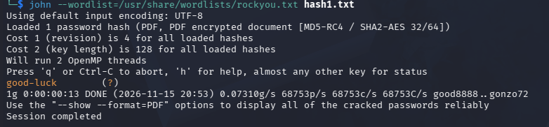
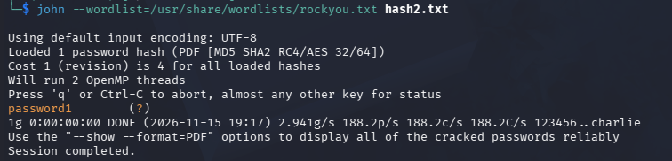
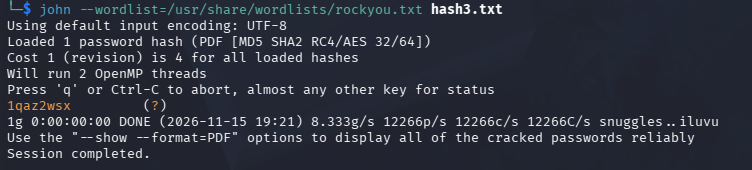
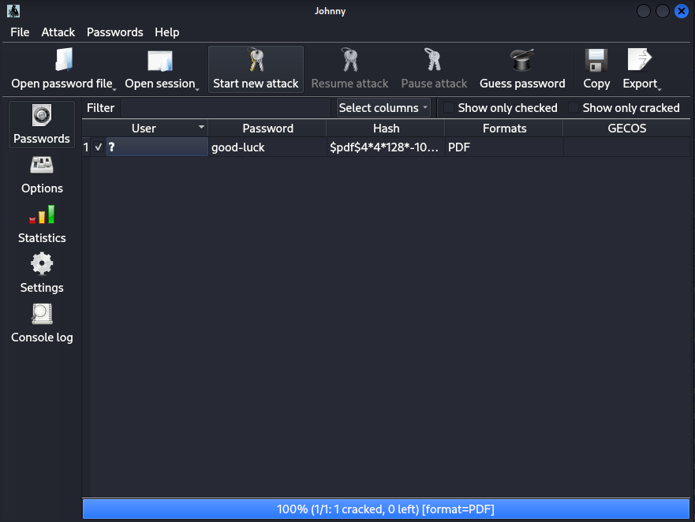
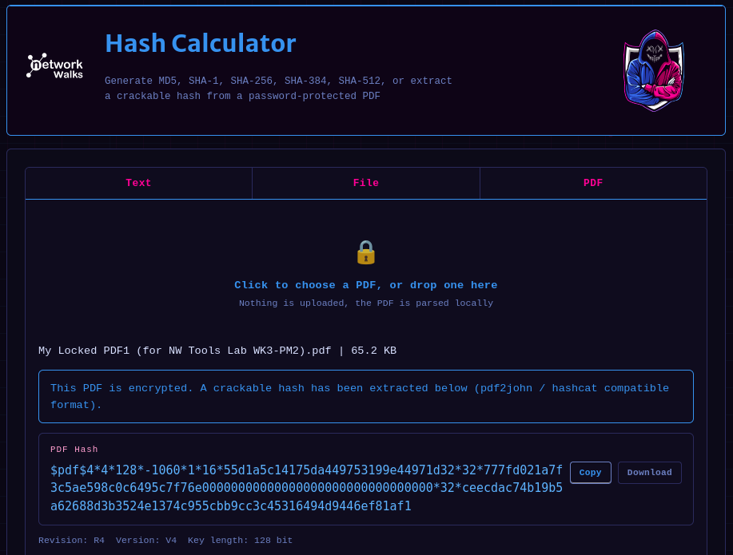
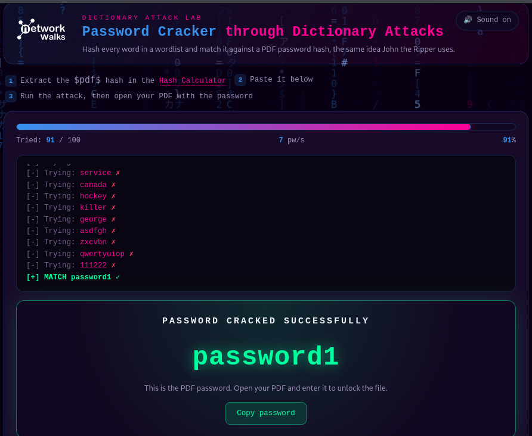

<h1 align="center">Password Cracking with Multiple Tools</h1>

<p align="center">
  PDF password hash extraction and cracking using John the Ripper, Johnny GUI, and online tools.
</p>

<p align="center">
  
  
  
</p>

<p align="center">
  <a href="https://www.onlinehashcrack.com/tools-pdf-hash-extractor.php">
    
  </a>
  <a href="https://networkwalks.com/hash-calculator/">
    
  </a>
  <a href="https://networkwalks.com/password-cracker/">
    
  </a>
</p>


## Tools
- John the Ripper (CLI)
- Johnny (JTR GUI)
- RockYou Wordlist
- Online PDF Hash Extractor
- NetworkWalks Hash Calculator
- NetworkWalks Password Cracker

## Setup and Install Johnny (JTR GUI)

Install the required dependencies:

```bash
sudo apt-get install g++ git qtbase5-dev
```

Clone the repository and build Johnny:

```bash
git clone https://github.com/shinnok/johnny.git
cd johnny
git checkout v2.2
export QT_SELECT=qt5
qmake && make -j$(nproc)
```

## Cracking Locked PDF File

### Password Cracking with John the Ripper

#### 1. Extract the PDF Hash

Extract the password hash from the protected PDF:

```bash
pdf2john 'My Locked PDF1.pdf' > hash1.txt
```

> Alternatively, use the online [PDF Hash Extractor](https://www.onlinehashcrack.com/tools-pdf-hash-extractor.php) to get hash value

#### 2. Crack the Hash Using JTR

Perform a dictionary attack using the RockYou wordlist:

```bash
john --wordlist=/usr/share/wordlists/rockyou.txt hash1.txt
```





#### 3. Unlocked the PDF with the recovered password

| PDF File | Recovered Password | Flag |
|---|---|---|
| PDF1 | `good-luck` | `nw{cybersecurity_flag_captured_2608}` |
| PDF2 | `password1` | `nw{networkwalks_persistence_jtr_270521}` |
| PDF3 | `1qaz2wsx` | `nw{networkwalks_flag_260821_1}` |

### Password Cracking with Johnny (JTR GUI)

#### 1. Launch Johnny

```bash
./johnny
```

#### 2. Crack the password

1. Open the extracted hash file (`hash1.txt`).
2. Select **Start New Attack**.
3. Configure the attack using the RockYou wordlist.
4. Start the cracking process.
5. Check the results for recovered passwords.



#### 3. Unlocked the PDF with the recovered password


### Password Cracking with NetworkWalks Tools

#### 1. Generate a Hash with Networkwalk tools

Use the NetworkWalks [Hash Calculator](https://networkwalks.com/hash-calculator/) to generate a hash from the input password.



#### 2. Attempt Password Recovery

Use NetworkWalks [Password Cracker](https://networkwalks.com/password-cracker/) to recover the password.



#### 3. Unlocked the PDF with the recovered password

- **Recovered Password:** `password1`
- **Flag:** `nw{networkwalks_flag1_jtr_270521_1}`

### Lessons Learned
- Password cracking requires the hash extracted from the target file, not the original file itself.
- Hash extraction converts protected-file password data into a format that cracking tools can process.

---

<div align="center">
  <sub> Created by <a href="https://github.com/n-afiqa/">@n-afiqa</a> · © 2026.</sub>
</div>